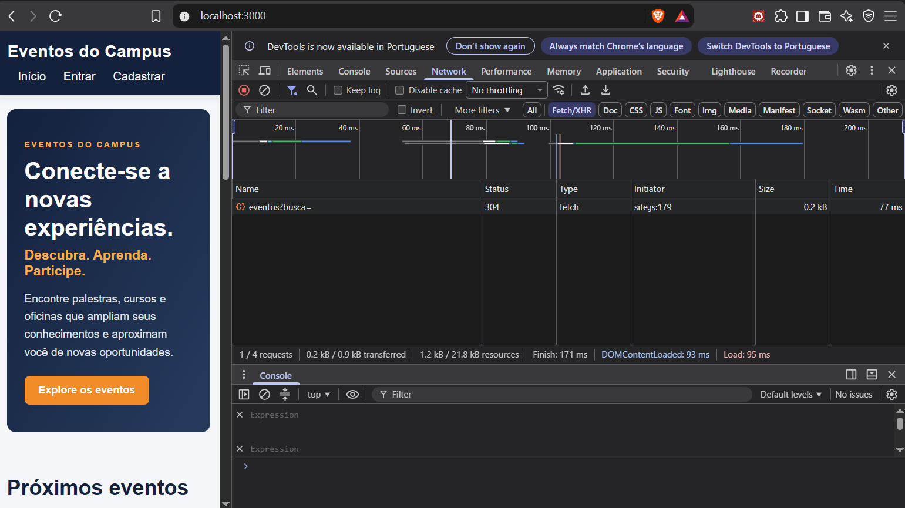
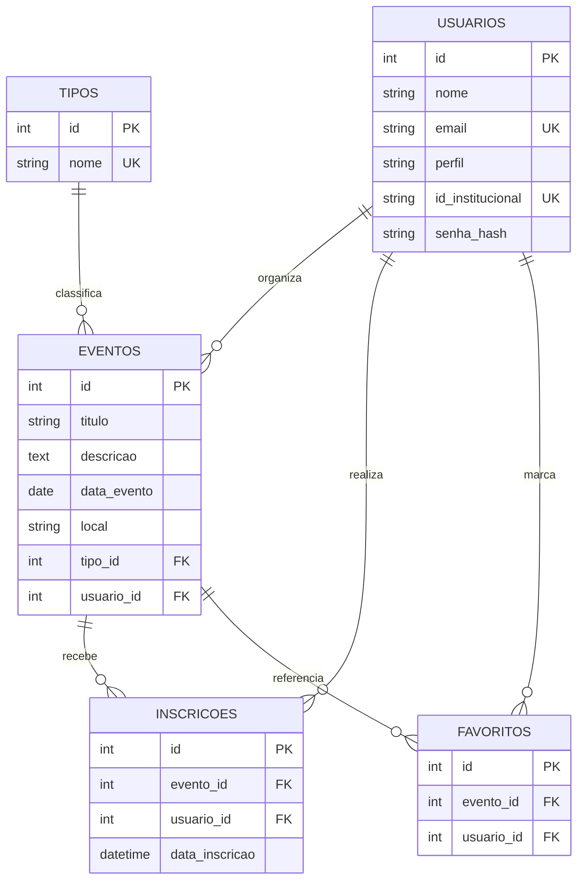

# Eventos da Faculdade

Sistema MVC com Express e EJS para publicar eventos acadêmicos, permitir inscrições de alunos e administrar eventos por organizadores.

## Requisitos

- Node.js 18 ou mais recente
- XAMPP com MySQL/MariaDB ligado

## Rodar no computador

1. No phpMyAdmin, importe `banco.sql` para criar o banco e os dados de demonstração locais. **O script apaga e recria `eventos_db`; execute-o somente se puder perder os dados atuais. As contas nele são apenas para desenvolvimento e usam a senha de demonstração `Eventos!26`. Não publique o sistema com essas contas. Antes de implantar, remova as três contas de demonstração e cadastre usuários reais com credenciais e IDs institucionais próprios.**
2. Na pasta do projeto, copie `.env.exemplo` para `.env`:

   ```powershell
   Copy-Item .env.exemplo .env
   ```

3. Gere um segredo novo para a sessão:

   ```powershell
   node -e "console.log(require('crypto').randomBytes(48).toString('hex'))"
   ```

   Cole o resultado em `SESSION_SECRET` no `.env`. Não compartilhe nem envie esse arquivo ao GitHub. O servidor recusa segredos ausentes ou menores que 32 caracteres.

4. Confira no `.env` os dados do MySQL do seu XAMPP. Para desenvolvimento local, `DB_USER=root` pode ser usado conforme a configuração local do XAMPP.
5. Instale as dependências e inicie:

   ```powershell
   npm install
   npm run dev
   ```

6. Abra a URL indicada no terminal. Para executar os testes automatizados:

   ```powershell
   npm test
   ```

## Contas e permissões

- O cadastro público cria somente contas de aluno.
- A faculdade cadastra os organizadores e fornece o ID institucional.
- Somente organizadores autenticados podem criar eventos; edição e exclusão também verificam que o evento pertence ao organizador.
- Alunos podem se inscrever e cancelar somente as próprias inscrições.

## Contas locais para teste

Todas as contas de demonstração usam a senha `Eventos!26`.

- Aluno: `teste@faculdade.com`
- Organizador 1: `organizador1@faculdade.com`, ID institucional `FAC-ORG-001`
- Organizador 2: `organizador2@faculdade.com`, ID institucional `FAC-ORG-002`

Use essas credenciais somente no banco local. Elas são públicas no arquivo de seed e não devem ser usadas em produção.

## Documento de visão (C1)

O documento de visão do projeto está em [`docs/visao-do-projeto.md`](docs/visao-do-projeto.md).

## ORM e relacionamentos

O projeto usa Sequelize como ORM: cada model JavaScript representa uma tabela existente e operações como `findAll`, `create`, `update` e `destroy` geram as consultas SQL. Os cinco models e suas associações estão em `src/models/index.js`. `Tipo 1:N Evento` usa `eventos.tipo_id`; `Usuario 1:N Evento` usa `eventos.usuario_id`. `Inscricao` e `Favorito` ligam usuários a eventos por meio de suas próprias chaves estrangeiras. Os nomes atuais das tabelas e colunas são mantidos, e o aplicativo não recria o banco automaticamente.

## API JSON de eventos e favoritos

As rotas usam a sessão do site. Requisições POST, PUT e DELETE precisam enviar o token CSRF da página em `X-CSRF-Token` (ou `_csrf` em formulários). Criar, editar e excluir eventos exige sessão de organizador; consultar e alterar favoritos exige sessão de aluno.

| Método | Rota | Acesso | Resultado |
| --- | --- | --- | --- |
| GET | `/api/eventos?busca=texto` | Público | Lista eventos futuros; visitantes e alunos não recebem a contagem de inscritos |
| GET | `/api/eventos/:id` | Público | Consulta um evento; retorna 400 para ID inválido e 404 se não existir |
| GET | `/api/eventos/favoritos/lista` | Aluno autenticado | Lista os eventos favoritados pelo aluno; retorna 200 |
| POST | `/api/eventos` | Organizador autenticado | Cria evento; retorna 201 |
| PUT | `/api/eventos/:id` | Organizador autenticado | Atualiza evento próprio; retorna 200 |
| DELETE | `/api/eventos/:id` | Organizador autenticado | Exclui evento próprio; retorna 204 |
| POST | `/api/eventos/:id/favorito` | Aluno autenticado | Adiciona favorito; retorna 200, ou 400/404 para ID inválido/evento inexistente |
| DELETE | `/api/eventos/:id/favorito` | Aluno autenticado | Remove favorito; retorna 200 |

Exemplo de corpo JSON para criar ou atualizar:

```json
{
  "titulo": "Palestra de tecnologia",
  "descricao": "Conversa com profissionais da área.",
  "data_evento": "2026-12-02",
  "local": "Auditório",
  "tipo_id": 1
}
```

Respostas de erro não incluem mensagens do banco: 400 para dados inválidos, 401 para falta de login, 403 para perfil ou CSRF inválido, 404 para recurso ausente e 500 para falhas inesperadas.

## Evidência AJAX (C4)

Na página inicial, a busca de eventos usa `fetch` e atualiza a lista sem recarregar a página. A captura abaixo mostra a requisição real na aba Network do navegador local.



## Segurança

- Senhas novas têm no mínimo 10 caracteres, pelo menos uma letra maiúscula e pelo menos um símbolo. Não é obrigatório usar número.
- O sistema usa bcrypt com custo 10 e rejeita senhas acima de 72 bytes UTF-8 para evitar truncamento.
- Tentativas de login e de cadastro são limitadas a 10 por endereço IP a cada 15 minutos.
- O cadastro informa quando o e-mail já está registrado. Para abrir o serviço ao público, substitua essa resposta por um fluxo de confirmação/recuperação de e-mail com resposta genérica; esta versão não está configurada para enviar e-mails.
- O limitador de tentativas guarda contadores na memória do processo. Se executar várias instâncias do Node em produção, configure um armazenamento compartilhado para que todas apliquem o mesmo limite.
- Tokens CSRF protegem formulários e requisições que alteram dados. O cookie de sessão usa `HttpOnly` e `SameSite=Lax`.
- Em desenvolvimento, as sessões ficam em memória. Com `NODE_ENV=production`, são persistidas no MySQL numa tabela `sessions`, criada automaticamente.
- Em produção, configure HTTPS e use uma conta MySQL própria com permissões limitadas. Deixe `TRUST_PROXY=0` no XAMPP local. Só use `TRUST_PROXY=1` se houver um proxy reverso confiável e o servidor Node ficar inacessível diretamente pela internet (restrinja a porta do Node no firewall para aceitar conexão apenas do proxy). Essa opção confia em um salto de proxy para obter o IP do cliente; se o Node também aceitar conexões diretas, alguém pode falsificar o cabeçalho de IP e contornar a limitação de tentativas de login.
- `.env`, `node_modules/`, `tmp/` e arquivos internos de trabalho são ignorados pelo Git. Compartilhe apenas `.env.exemplo`, sem valores secretos.

### Checklist de segurança e auditoria (C6)

| Item | Teste ou evidência | Resultado | Correção |
| --- | --- | --- | --- |
| Senhas protegidas | Testes da política e do fluxo bcrypt; teste compara a senha de demonstração com os três hashes do `banco.sql` | Aprovado | Senhas são processadas com bcrypt antes de salvar; manter custo e política revisados. |
| Proteção CSRF | Testes de POST sem token, token válido e token adulterado | Aprovado | Middleware recusa operações de escrita sem token válido. |
| Sessão após login | Teste de rotação do ID da sessão | Aprovado | O login regenera a sessão antes de gravar o usuário autenticado. |
| Limite de tentativas | Testes enviam 11 cadastros e 11 logins no mesmo período; a última tentativa de cada fluxo recebe 429 | Aprovado | Manter limite de 10 tentativas por IP em 15 minutos. |
| Dono do evento | Teste de atualização por outro organizador e inspeção da exclusão | Aprovado | Atualização e exclusão filtram por `usuario_id` do organizador autenticado. |
| Segredo de autorização nos logs | Auditoria encontrou os códigos configurado e digitado sendo enviados a `console.log`; teste de regressão confirmado após a remoção | Corrigido | Logs removidos; `test/authControllerSecurity.test.js` confirma que o cadastro não registra os códigos. |
| Dados de saída em HTML | Inspeção das views confirma uso de `<%= %>` para escapar conteúdo dinâmico | Aprovado por inspeção | Continuar usando saída escapada; evitar `<%- %>` para dados fornecidos por usuários. |

Os testes automatizados foram executados localmente: **30 aprovados, 0 falhas**. A tabela registra os checks executados nesta revisão; não substitui uma nova auditoria antes da publicação.

## Banco de dados e diagrama ER

O script `banco.sql` cria cinco tabelas. `usuarios`, `tipos` e `eventos` são as entidades principais. `inscricoes` e `favoritos` registram as relações entre alunos e eventos.

| Tabela | Campos principais | Chaves estrangeiras e regras |
| --- | --- | --- |
| `usuarios` | `id`, `nome`, `email`, `perfil`, `id_institucional`, `senha_hash` | `email` é único; `id_institucional` é opcional e único. A senha é armazenada como hash. |
| `tipos` | `id`, `nome` | `nome` é único. |
| `eventos` | `id`, `titulo`, `descricao`, `data_evento`, `local`, `tipo_id`, `usuario_id` | `tipo_id` referencia `tipos.id`; `usuario_id` referencia `usuarios.id`. |
| `inscricoes` | `id`, `evento_id`, `usuario_id`, `data_inscricao` | `evento_id` referencia `eventos.id`; `usuario_id` referencia `usuarios.id`. O par `(usuario_id, evento_id)` é único. |
| `favoritos` | `id`, `evento_id`, `usuario_id` | `evento_id` referencia `eventos.id`; `usuario_id` referencia `usuarios.id`. O par `(usuario_id, evento_id)` é único. |

O diagrama mostra as relações 1:N pelas chaves estrangeiras. `inscricoes` e `favoritos` representam relações N:N separadas entre usuários e eventos.



## Uso de inteligência artificial

IA generativa foi usada como apoio na implementação dos modelos Sequelize, na documentação e na revisão de segurança. A estudante deve revisar as mudanças e saber explicar o código na apresentação.

## Git e histórico de desenvolvimento

Este é um projeto individual. O repositório pessoal no GitHub registra o histórico de desenvolvimento, e os commits devem ficar associados à conta da estudante. `.env` e `node_modules/` permanecem fora do repositório; compartilhe apenas `.env.exemplo`, sem valores secretos.
